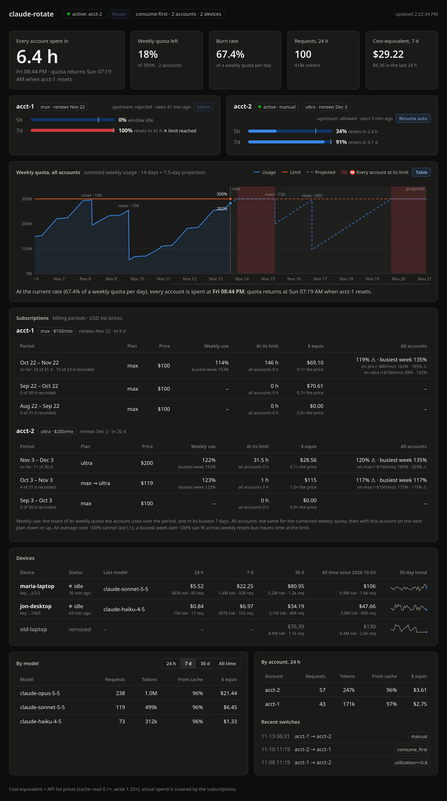
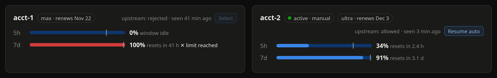

# claude-rotate


[](https://github.com/doxaras/claude-rotate/actions/workflows/tests.yml)


A tiny self-hosted proxy that lets **Claude Code** ride multiple Claude
Max/Pro subscriptions and switches accounts automatically when one hits its
rate-limit window — with a built-in analytics panel showing quota gauges,
per-device consumption, and cost-equivalent dollars.

One process, one config file, no database. Built for individual developers who
own more than one subscription and are tired of "You've hit your session
limit".

Before deployment, read [Security and Tailscale setup](SECURITY.md) for credential
handling, private access, request limits, and the shared-device trust model.

**Herd-safe, by test — not by vibes:** when your whole fleet slams into a rate
limit at the same instant, exactly *one* rotation decision happens — 100
in-flight requests, 1 switch, and every request recovers with a single retry
onto the new account. Reproducible numbers in
[Performance](#performance-herd-safe).

> **Terms-of-Service note.** This tool automates switching between accounts
> *you personally own and pay for*. Each account's limits are still fully
> enforced by Anthropic. Rotating accounts to work past limits is a gray area
> under Anthropic's consumer terms — use at your own risk, and do **not** use
> consumer subscriptions to back a shared/commercial service.

**Contents:**
[How it works](#how-it-works) ·
[Performance](#performance-herd-safe) ·
[Quickstart: server](#quickstart-server) ·
[Generating tokens](#generating-account-tokens-claude-setup-token) ·
[Quickstart: devices](#quickstart-each-device) ·
[Networking](#connecting-distributed-devices) ·
[Analytics panel](#analytics-panel) ·
[Configuration](#configuration-configjson) ·
[Run as a service](#run-as-a-service) ·
[Troubleshooting](#troubleshooting) ·
[Limitations](#limitations) ·
[Operations](#operations) ·
[Comparison](#comparison-with-similar-projects) ·
[Security](#security-notes) ·
[License](#license)

## How it works


Per request the proxy: authenticates the device (device key → device name),
swaps in the active account's long-lived setup-token, forwards transparently,
reads the exact `anthropic-ratelimit-unified-*` quota headers off the
response, applies the rotation policy (consume-first; quota 429 → rotate,
burst 429 → pace, all spent → hold), and logs usage per device/model.
Diagram regenerates with `python3 screenshots/architecture.py`
(needs `pip install diagrams` + graphviz).

Key insight: Claude Code respects `ANTHROPIC_BASE_URL`, and `claude
setup-token` mints a ~1-year OAuth token per account. The proxy holds those
tokens; devices only ever hold an internal *device key*. Every response from
Anthropic carries exact quota telemetry headers, so switching at 80% is
measured, not guessed.

## Performance (herd-safe)

The point of a *server* proxy is that a whole fleet leans on it at once — so
high-concurrency behavior is tested, not assumed. All numbers from the
reproducible stress suite (`python3 tests/test_stress.py`, mocked upstream,
Apple-silicon dev machine — run it on yours):

| Scenario | Result |
|---|---|
| 300 concurrent requests | every one served, audit complete, **~3,500 req/s** proxy overhead ceiling |
| Quota limit hit with **100 requests in flight** (50 ms simulated upstream RTT) | **exactly 1 switch** — the in-flight herd hits the dying account once each (they were already on the wire), then every request retries **once** onto the survivor; all 100 recover |
| 50 burst-429s across 100 concurrent requests | **0 rotations** — paced on the same account, prompt caches kept warm |
| All accounts spent, 20 requests arrive | all park via hold-until-reset and release **together** at the window reset |
| 50 parallel SSE streams | byte-identical relay, usage audited on every stream |
| 50,000-row audit log | analytics rollup in **0.42 s** |

Why this matters with a fleet: the failure mode of naive rotators under load
is the *switch* stampede — N in-flight requests each trigger their own switch,
the account pool burns down in seconds, and every device's prompt cache is
thrown away N times. Here a single lock serializes the decision: one switch,
everyone else rides it. To be precise about what the lock can and cannot do:
requests already on the wire when the quota hits still reach the dying account
once each — nothing can un-send them — but there is exactly one switch and
exactly one retry per request, and both counts are asserted in the test.

Honest scope: single process by design (state lives in one place — don't run
uvicorn workers), and the upstream is mocked (the race test adds 50 ms of
simulated RTT), so figures measure the proxy's own overhead and race behavior,
not Anthropic latency.

## Quickstart (server)

Requires Python 3.10+ and three packages: `fastapi`, `httpx`, `uvicorn`
(pinned in `requirements.txt`). Any always-on box works — a Mac mini, a
home-lab Linux machine, a small VPS.

```bash
git clone <this repo> && cd claude-rotate
pip install -r requirements.txt
./setup.sh                      # creates config.json, tokens/, logs/
./setup.sh add-account acct-1   # paste token from: claude setup-token  (account 1's browser)
./setup.sh add-account acct-2   # …account 2
./setup.sh add-device my-laptop # prints the env vars for that device
python3 rotator.py
```

That is the standalone, run-it-yourself layout. On a Debian 12 server, install
it as a hardened systemd service instead and administer it from any directory:

```bash
git clone <this repo> && cd claude-rotate
sudo ./install.sh                               # leaves the service stopped until configured
sudo claude-rotate-admin add-token acct-1       # paste token from: claude setup-token
sudo claude-rotate-admin add-user my-laptop     # prints the env vars for that device; starts the service
sudo claude-rotate-admin status
```

`sudo ./uninstall.sh` removes the service again and keeps your config and tokens
(`--purge` deletes them). See [OPERATIONS.md](OPERATIONS.md) for the admin
commands, including `rotate`, and [deploy/README.md](deploy/README.md) for what
the installer does.

## Generating account tokens (`claude setup-token`)

Each subscription account contributes one long-lived OAuth token. Facts below
are from the [official authentication docs](https://code.claude.com/docs/en/authentication.md)
unless flagged otherwise.

**Minting a token:**

```bash
claude setup-token
```

- Opens the same browser OAuth flow as `/login`; if no browser can reach the
  local callback (headless server, SSH session), it falls back to a paste-a-code
  flow — so you can mint tokens on the proxy server itself.
- Prints a token starting `sk-ant-oat01-…` to the terminal and does **not**
  save it anywhere — copy it straight into `./setup.sh add-account <name>`
  (standalone: stores it under `tokens/`, chmod 600, gitignored) or into
  `sudo claude-rotate-admin add-token <name>` (Debian service: stores it under
  `/etc/claude-rotate/tokens/`, readable by root and the service only).
- Valid for **about one year**. Requires a Claude subscription (Pro, Max,
  Team, or Enterprise).

**Minting for multiple accounts from one machine.** The account that completes
the browser OAuth is the account the token belongs to — the CLI's current
login doesn't decide it. (Officially undocumented; this is the behavior in
practice.) Two workable recipes:

1. **Browser profiles**: keep one browser profile (or incognito window) logged
   into claude.ai per account. Run `claude setup-token`, and complete the OAuth
   in the profile of the account you're minting for — copy the URL into that
   profile if the wrong one opens.
2. **Config-dir isolation**: `CLAUDE_CONFIG_DIR=~/.claude-acct2 claude
   setup-token` keeps a fully separate CLI login per directory, useful if you
   also want to *run* Claude Code as different accounts.

After adding an account, send one request through the proxy and check
`/rotate/status` — the unified utilization headers it reports are per-account,
so a token minted against the wrong account shows up immediately as the wrong
gauge moving.

**Lifetime & revocation:**

- There is currently **no CLI command to list or revoke** setup tokens
  ([open feature request](https://github.com/anthropics/claude-code/issues/57400));
  revoke manually from claude.ai settings. `/logout` only revokes the CLI's
  *active* session credential, not previously minted setup tokens.
- Treat each token file as a year-long bearer credential for that Anthropic
  account (see [Security notes](#security-notes)). When a token dies early, the
  proxy's upstream calls start returning 401 for that account — the roadmap has
  an alert for this.
- Scope note: subscription OAuth tokens are for Claude Code traffic — which is
  all this proxy forwards — and per the 2026 docs they are rejected by the raw
  Messages API.

## Quickstart (each device)

Two env vars in your shell profile — that's the whole client install:

```bash
export ANTHROPIC_BASE_URL=http://<server>:8484
export CLAUDE_CODE_OAUTH_TOKEN=<device key printed by add-device>
```

Run `claude` as usual. When account 1's 5-hour window fills, the next request
rides account 2. Use a VPN/overlay like Tailscale between devices and server —
the proxy speaks plain HTTP and device keys are bearer secrets. See
[Connecting distributed devices](#connecting-distributed-devices) for setups.

## Connecting distributed devices

The proxy is plain HTTP and device keys are bearer secrets, so the transport
between devices and server must be private. Pick one:

### Same LAN / subnet (nothing to install)

If every device lives on the same trusted network as the server — home lab,
office LAN — you don't need Tailscale or any overlay at all:

```bash
# on the server: find its LAN address
ipconfig getifaddr en0        # macOS (en0 = Ethernet/Wi-Fi)
hostname -I                   # Linux

# on each device:
export ANTHROPIC_BASE_URL=http://192.168.1.42:8484
```

- **macOS servers get a free stable name** via Bonjour/mDNS:
  `http://<hostname>.local:8484` (e.g. `http://mac-mini.local:8484`) works from
  Macs, iPhones, and most Linux devices (with `avahi-daemon`) — no IP to
  remember. Otherwise give the server a **DHCP reservation** in your router so
  its IP never changes under the devices pointing at it.
- Set `bind` in `config.json` to the LAN IP (or keep `0.0.0.0` if the box has
  only one network). Verify from a device: `curl http://<server>:8484/rotate/status?key=<device key>`.
- **Do not port-forward 8484 on your router.** LAN-only means the firewall
  boundary is your router's NAT; forwarding the port turns this into the
  internet-exposed scenario below.

The trust caveat: traffic is plain HTTP, so anyone on the same subnet can read
device keys off the wire. Fine for a home network you control; on a shared
office network or anywhere with guests, prefer one of the encrypted options
below. And a hybrid is normal — LAN for the desktop next to the server,
Tailscale for the laptop that leaves the house.

### Tailscale (recommended)

Zero-config WireGuard mesh; free tier covers personal use easily.

```bash
# on the server AND every device:
#   macOS:  brew install tailscale && brew services start tailscale
#   Linux:  curl -fsSL https://tailscale.com/install.sh | sh
tailscale up                      # login once per machine, same tailnet
tailscale status                  # note the server's name / 100.x.y.z address
```

With MagicDNS on (default on new tailnets), devices reach the server by name:

```bash
export ANTHROPIC_BASE_URL=http://<server-hostname>:8484   # e.g. http://my-server:8484
export CLAUDE_CODE_OAUTH_TOKEN=<device key>
```

Tighten the listener so the proxy is *only* reachable over the tailnet — set
`bind` in `config.json` to the server's Tailscale IP instead of `0.0.0.0`:

```json
{ "bind": "100.x.y.z", "port": 8484 }
```

Optional TLS: `tailscale serve --bg http://127.0.0.1:8484` publishes the proxy
as `https://<server>.<tailnet>.ts.net` (valid cert, tailnet-only). Then use
that URL as `ANTHROPIC_BASE_URL` and set `bind` to `127.0.0.1`.

CI runners and containers work too: ephemeral auth keys
(`tailscale up --auth-key=tskey-...`) join a runner to the tailnet for the
duration of a job; there's a ready-made GitHub Action (`tailscale/github-action`).

### Plain WireGuard

Same effect, no third party. Sketch: generate a keypair per machine
(`wg genkey | tee private.key | wg pubkey > public.key`), give the server a
`wg0` with an internal subnet (e.g. `10.84.0.1/24`), add each device as a
`[Peer]` with `AllowedIPs = 10.84.0.X/32`, and point devices at
`http://10.84.0.1:8484`. Set `bind` to `10.84.0.1`. More manual than
Tailscale (key distribution, NAT traversal is on you), but fully self-hosted.

### SSH tunnel (zero install)

Any device that can SSH to the server needs nothing else:

```bash
ssh -N -L 8484:127.0.0.1:8484 user@server &
export ANTHROPIC_BASE_URL=http://127.0.0.1:8484
```

With `bind: 127.0.0.1` on the server, this is the tightest setup — the proxy
never listens on a network interface at all. Use `autossh` (or
`ServerAliveInterval 30` in `~/.ssh/config`) to keep the tunnel up; fine for a
laptop or a single CI box, tedious beyond a few devices.

### Cloudflare Tunnel (device without VPN access)

For a device that can't join your tailnet (locked-down corp machine, hosted
CI you can't install agents on), `cloudflared` can expose the proxy through
Cloudflare without opening ports:

```bash
# server:
cloudflared tunnel login
cloudflared tunnel create claude-rotate
cloudflared tunnel route dns claude-rotate rotate.example.com
cloudflared tunnel run --url http://127.0.0.1:8484 claude-rotate
# device:
export ANTHROPIC_BASE_URL=https://rotate.example.com
```

**This makes the proxy internet-reachable** — the only thing between the
world and your Anthropic tokens is the device-key check. If you go this
route, put [Cloudflare Access](https://developers.cloudflare.com/cloudflare-one/)
(a Zero Trust service-token policy) in front so unauthenticated requests never
reach the proxy, and treat device keys as revocable: delete a leaked one from
`config.json` and restart. Prefer any of the VPN options above when possible.

### Other overlays

ZeroTier and NetBird work identically to Tailscale for this purpose (private
overlay IP + `bind` to it); use whichever your fleet already runs. Whatever
the transport, the checklist is the same: proxy bound to a private interface,
HTTP never exposed publicly, one device key per machine so any single machine
can be revoked alone.

## Analytics panel

Open `http://<server>:8484/rotate/panel?key=<any device key>`:



Live 5-hour and weekly gauges per account, straight from Anthropic's own
rate-limit headers:



- **Headline** — time until every account is spent, with when it happens and
  which reset brings quota back; tiles for weekly quota left, burn rate,
  requests in the last 24 h and the 7-day cost-equivalent. Alerts (device over
  N tokens/hour, account near the switch threshold; thresholds in
  `config.json`) sit in a banner above it.
- **Accounts** — live 5-hour and weekly meters (from Anthropic's own headers)
  with a tick at the switch threshold, reset countdowns, upstream status and
  the active account. **Select** on an account, or **Rotate** next to the
  active account (the next usable one in config order), switches to it after a
  confirmation. The pick holds: consume-first and priority recovery leave it
  alone until it reaches a switch threshold, runs out of quota or is disabled.
  **Resume auto** hands it back to the strategy earlier.
- **Weekly quota, all accounts** — the enabled accounts' current weekly
  usage, summed (blue), against their combined capacity (orange: 100% per
  account, scaled by its plan's weight). Usage drops at each account's weekly
  reset by what that week used. A 7.5-day projection spends the last 24 h rate
  consume-first, pauses usage while every account is spent, and drops it at
  each projected reset; it states when every account first reaches 100% and
  when the next reset brings quota back. The rate counts only rises in usage,
  so a reset does not cancel consumption. Periods when every account was or
  will be at its limit are shaded. The chart opens on 7.5 days either side of
  now (3.5 days on a phone) and scrolls back to the first sample. Hover or tap
  for values; **Table** shows the same data as a table. History is sampled
  every 30 min into `usage_history.json` next to `state.json` and kept 14 days.
- **Subscriptions** — for each account with `billing` set: its plan, price and
  renewal date, and one row per billing period (the last 13). A row shows the
  plan (an upgrade inside the period prorates the price by days), how much of
  its weekly quota the account used on average and in its busiest week, hours
  at its weekly limit and hours with every account at its limit, and the
  period's cost-equivalent against the price. The last column decides a plan
  change: the most of the accounts' combined weekly quota used in any 7 days,
  then the same with this account on the next plan down or up. Over 100% means
  every account would have run out; well under it on the plan down means the
  cheaper plan would have done. Rotation makes the accounts interchangeable,
  which is why this column looks at all of them: consume-first runs each
  account to its limit by design, so one account's hours at its limit say
  little on their own. Use is recorded from the weekly samples, so a period
  before the history starts shows how many of its days are covered.
- **Devices** — every registered device (online status, last seen, last model)
  and every removed device that still has history, with usage over 24 h, 7 d,
  30 d and all time plus a 30-day cost trend. 7 d and 30 d are calendar days,
  today included.
- **By model** (24 h / 7 d / 30 d / all time) and **by account** (24 h) —
  requests, tokens, the share of prompt tokens served from cache, and a
  *cost-equivalent* column: what the usage would cost at API list prices (incl.
  cache read 0.1× / write 1.25×) — i.e. what the subscriptions are saving you.

The 24 h figures come from the audit log. Longer periods come from
`device_usage.json` next to `state.json`: daily totals per device and model for
31 days plus all-time totals, and per account for 400 days (requests, cost,
weekly-quota use and time at the limit) for the billing periods. It is updated
with every request and saved every minute. On first start it is rebuilt once
from `audit.jsonl` and its rotated copies, and the weekly-quota part from
`usage_history.json`, so all time reaches back as far as those files do.

JSON endpoints: `/rotate/status` (accounts + switch events) and
`/rotate/stats` (rollups, alerts, the longer `periods` and `billing`), same `?key=` or `Authorization: Bearer`
auth. `POST /rotate/switch` with `{"account": NAME}` or `{"auto": true}` is the
panel's switch; it accepts only `application/json`. Audit trail: `logs/audit.jsonl`, one JSON record per request.

On either Claude endpoint, `rate_limits` lists upstream 429s, including ones
the proxy retried. Each entry records the account, rotation verdict, raw
`Retry-After`, rate-limit headers, and the upstream error type and message when
available. The audit keeps the first nine and the latest attempt if there are
more than ten, and counts omitted attempts in `rate_limits_omitted`.

`ratelimit` captures the final answer's rate-limit headers for Fable requests
and for answers without the unified 5-hour utilization header. These snapshots
help identify model-specific limits and explain missing utilization readings.
Both fields keep up to 40 `anthropic-ratelimit-*` headers, with the prefix removed,
names capped at 100 characters, and values capped at 200. If the audit record
would exceed the file limit, the proxy strips these snapshots and marks it
`ratelimit_truncated`.

## OpenAI-compatible endpoint

`POST /v1/chat/completions` (same device-key auth) accepts OpenAI-format chat
requests — streaming included — and rides the same rotated accounts, so any
OpenAI-format app or LLM router can use the capacity, not just Claude Code:

```bash
curl http://<server>:8484/v1/chat/completions \
  -H "Authorization: Bearer <device key>" -H "content-type: application/json" \
  -d '{"model":"claude-sonnet-5","max_tokens":256,
       "messages":[{"role":"user","content":"hello"}]}'
```

Text conversations only (tool use → 400). When every account's window is spent
it returns `503` + `Retry-After: <seconds to earliest reset>` — point a
router's circuit breaker at that. Responses carry `x-rotate-account` and the
upstream `anthropic-ratelimit-unified-*` headers for per-request telemetry.

## Other providers

The same process can hold credentials for other AI providers, so a coding agent
holds only a device key you issued and can revoke. Each provider gets its own
path prefix; the bare root stays the rotated Claude accounts, unchanged.

```json
"providers": {
  "openai": {"kind": "openai-siwc"},
  "openrouter": {"kind": "static-bearer", "upstream": "https://openrouter.ai/api",
                 "token_file": "tokens/openrouter.token"}
},
"devices": {
  "my-laptop": "dev-my-laptop-…",
  "team-a": {"key": "dev-team-a-…", "providers": ["openai"]},
  "desk": {"key": "dev-desk-…", "providers": ["anthropic", "openai", "openrouter"]}
}
```

- **`static-bearer`**: `upstream` is a base URL (no user info, query or
  fragment), `token_file` a file next to the account tokens. Requests under the
  prefix go to the upstream with `Authorization: Bearer <token>` in place of the
  device key. For OpenRouter, an employer's OpenAI-compatible endpoint, a model
  server on the LAN.
- **`openai-siwc`**: one "Sign in with ChatGPT" credential, used on ChatGPT plan
  usage ([OpenAI's flow](https://developers.openai.com/siwc/token-sharing-open-source)).
  It talks to `https://api.openai.com` and `https://auth.openai.com` only; neither
  can be configured, since a refresh sends the rotating refresh token. The
  credential is `credentials/<name>.json` in the state directory, which the proxy
  rewrites at every refresh. The access token lasts an hour: the proxy refreshes it
  ten minutes before expiry and not before OpenAI's `earliest_refresh_at`, one
  refresh at a time, writes the new tokens to disk before using them (the previous
  file is kept as `.prev`), and refreshes once if OpenAI answers a request with
  401, replaying the request only with a new token. That refresh is made at most
  once every 10 minutes, counting every refresh, so no run of requests can rotate
  the credential faster; within that time the caller gets OpenAI's 401. Failed
  refreshes back off from 30 s to 5 min. A refused refresh (`invalid_grant`, `invalid_client`,
  `refresh_token_reused`, `_expired` or `_invalidated`) takes the provider down,
  and so does a 200 that lacks either token or a usable expiry, since OpenAI has
  rotated the token by then: requests get 503 with the reason, the panel shows an
  alert, and a new sign-in is needed. The refusal is noted in the credential file
  itself, so a restart stays down and installing a new credential clears it.
- **Lost refresh answers.** When a refresh was sent but its answer never came
  (a timeout or a dropped connection), OpenAI may or may not have rotated the
  token. The proxy notes this in the credential file, backs off, and then sends
  the same refresh token once more. If OpenAI had rotated it, that try is refused
  as reused and the provider goes down: the state that requiring a new sign-in at
  once would have reached, without the sign-in when the first request never took
  effect. The cost is that OpenAI sees a reused refresh token for that sign-in,
  which its reuse detection may answer by revoking the sign-in's tokens; the
  proxy holds none of them by then. This does not rely on any grace period for a
  rotated token: OpenAI does not document one for this flow.
- **Status.** `/rotate/status` gives each provider a state: `ok`; `unavailable`
  when the access token has expired and no refresh can be made yet; `down` after
  a refusal or without a credential. Apart from the state, `unsaved` is set when
  the credential in memory is not on disk: a refreshed credential, a refusal or a
  lost answer that could not be written. The access token in memory keeps
  serving, since the spent refresh token cannot come back, but no further refresh
  is made until the save, retried every minute, works; once that token expires,
  requests get 503. A restart while `unsaved` is set needs a new sign-in. A crash
  between OpenAI's answer to a refresh and the rename of the new file also needs
  a new sign-in; that window is one write.
- **`prefix`** defaults to `/<name>`. It is one path segment and takes that
  segment away from the Claude passthrough; `/v1`, `/api`, `/rotate`, `/docs`,
  `/redoc` and `/anthropic` are refused.
- **Grants.** A device given as a string reaches the Claude accounts only, as
  before. The object form must list what the key may reach, `anthropic` being
  the Claude accounts; an object without the list fails startup. Anything not
  granted gets 403. `claude-rotate-admin grant NAME openai` and `revoke NAME
  openai` change an existing device in place and keep its key. A key opens the
  panel and its JSON endpoints only with the
  `anthropic` grant; with `panel_tailnet`, a tailnet user opens it whatever key,
  if any, the request carries.

Under a prefix, GET, POST, PUT, DELETE, PATCH, OPTIONS and HEAD are forwarded with
the same request and response limits, admission limit and header hygiene as the
Claude passthrough; the device key and upstream cookies are dropped, the body is
not rewritten, and responses get a sandbox `Content-Security-Policy` so a page
from the provider cannot run script on the proxy's origin. A path segment that
decodes to `.` or `..` or hides a `/` or `\` gets 400, here and on the Claude
passthrough.
Nothing there is paced or rotated: a 429 from another provider goes back to the
client and never touches a Claude account. An answer is relayed as it arrives
unless the upstream gives its length (OpenAI's `/v1/responses` streams carry no
Content-Type, so that header does not decide); only a sized answer is buffered and
held to `max_response_bytes`. Usage from Responses (`response.completed`), Chat
Completions and Anthropic-format answers, streamed or not, is recorded in the audit
log with a `provider` field and counted per device; OpenAI's cache reads and cache
writes are taken out of its `input_tokens` and recorded as cache read and cache
write, as for Claude. Costs are API list prices: built in for the Claude families and
OpenAI's current GPT models (Standard tier, short context, read
2026-11-19), with `prices_per_mtok` in `config.json` changing or adding entries. They
understate a request above 272K input tokens, which OpenAI bills at a higher
long-context rate. A provider model no entry names counts as $0 rather than at a
made-up Claude price. A request's cost is added to the daily and all-time totals
when it is recorded, so a price change applies from then on there; the 24-hour
figures are worked out again from the audit log and follow it at once.

**Signing in.** On a machine with a browser:

```bash
python3 siwc_login.py login       # writes ~/.config/claude-rotate/openai.credential.json
scp ~/.config/claude-rotate/openai.credential.json server:
rm ~/.config/claude-rotate/openai.credential.json*
# on the server
sudo claude-rotate-admin install-credential openai --file openai.credential.json
rm openai.credential.json
```

The proxy is then the only holder of the credential. Any other copy that
refreshes kills it for both, so delete them. `claude-rotate-admin status` shows
the registered client and host ids; `siwc_login.py login --client-id … --host-id …`
signs in again to the same registration.

**Codex.** Point a provider entry at the gateway and give Codex the device key, in
`~/.codex/config.toml`:

```toml
model_provider = "gateway"

[model_providers.gateway]
name = "claude-rotate"
base_url = "https://YOUR-TAILSCALE-HOST/openai/v1"
wire_api = "responses"
env_key = "CLAUDE_ROTATE_KEY"        # export CLAUDE_ROTATE_KEY=<device key>
requires_openai_auth = false
supports_websockets = false
model_catalog_url = "https://YOUR-TAILSCALE-HOST/openai/v1/models"
```

Codex then sends `POST /openai/v1/responses` with `store: false` and
`stream: true`, which the plan route requires. Without `model_catalog_url`, Codex
(0.169.0) fetches no model catalog for a provider of its own: a model its release
does not know gets "Model metadata for ... not found", a generic prompt, generic
tools without `apply_patch` and a default context window. With it, Codex fetches
`GET /openai/v1/models?client_version=...` through the proxy with the device key.
To work from a saved copy of that catalog instead, set `model_catalog_json =
"<file>"` at the top level of `config.toml`. In this mode Codex shows no plan
usage in `/status`. OpenAI lists request fields and
tools this route refuses (`max_output_tokens`, `temperature`, image generation,
file search, hosted MCP, `tool_search` among them); the proxy passes such errors
through unchanged.

For an operation the route does not allow at all, such as `POST
/openai/v1/images/generations`, OpenAI answers 401 with error type
`rejected_by_hardened_oauth_boundary` ("This ChatPass credential is not authorized
for the requested operation"), although the credential is valid. The proxy hands
that answer to the client byte for byte, without a refresh or a replay, since a new
token would get the same answer. The audit record carries `upstream_error` (OpenAI's
error type) and `refresh_after_401` (skipped, held back, or attempted) for any 401.

**Image generation and web search.** The Sign in with ChatGPT route refuses images, but Codex's
`image_gen` tool is one JSON request to `<base_url>/images/generations` (or
`/images/edits`), which Codex makes itself. With `"images": true` in an `openai-siwc`
entry, the proxy sends those two requests to the ChatGPT backend Codex uses with its
own login (`https://chatgpt.com/backend-api/codex`), with a Codex ChatGPT login it
holds, billed to the same plan. The proxy also sends Codex's web search request
there with the Codex login. These are private endpoints. See
SECURITY.md before turning them on.

1. On the laptop, a login used for nothing else, then on the server:
   ```sh
   d=$(mktemp -d); CODEX_HOME=$d codex login; scp $d/auth.json server:; rm -r $d
   sudo claude-rotate-admin install-credential openai --images --file auth.json; rm auth.json
   ```
   Do not run `codex logout` in that directory: it revokes the login. The installer
   keeps the two tokens, the client and account ids and the expiry, nothing else.
2. Add `"images": true` to the provider entry and run `claude-rotate-admin activate`.
3. In each Codex that should make images and search the web, one more line in `config.toml`:
   ```toml
   [model_providers.gateway]
   # ... as above, plus:
   http_headers = { "x-openai-actor-authorization" = "claude-rotate" }
   ```
   Codex offers `image_gen` and its web search tool to a provider of its own only
   when that header is set (any value, stripped before forwarding). Both go through
   the Codex login (web search checked live on 2026-11-27). To keep a team off the
   web, add `web_search = "disabled"` at the top level.

Codex resends each generated image (about 1.3 MB of base64 for a 1536x1024 PNG) with
every later request of its thread, so under a provider with images the request
limit is `max_image_request_bytes` (32 MiB) instead of `max_request_bytes`; bodies
above `max_request_bytes` share `max_image_bytes_in_flight` (256 MiB, then 503), and
`max_concurrent_images` (2) image requests run at once, 8 more waiting, then 429. A
generation takes about 8 s. Answers are relayed as they come; an HTML error page
from the backend becomes a short JSON error, since Codex shows the model the body.
The audit record carries `route: "codex-images"`, the duration and the bytes.
Search uses `max_request_bytes`. With `"images": true`, the gateway sends
`POST /alpha/search` through the Codex login and returns 503 if the login is
unavailable. It buffers replies up to 4 MiB or `max_response_bytes`, whichever
is lower, and audits them as `route: "codex-search"` without search input or
results. Without `"images": true`, search follows the ordinary Sign in with
ChatGPT route.

**Quota.** The proxy keeps the plan's latest figures per limit and shows them in
`/rotate/status` (`quotas`), the panel's OpenAI card and `claude-rotate-admin status`.
It caches the figures in `provider_quotas.json` next to `state.json`. The panel
warns at 90 %. Image answers carry Codex's quota headers
(`x-codex-active-limit: imagegen_premium`, a 24-hour window), and the proxy
also accepts quota headers on inference answers when present. Model use
(`codex`, a 5-hour and a weekly window) is not in the Sign in with ChatGPT route's
answers, so with an images login installed the proxy reads it every 5 minutes from
`GET https://chatgpt.com/backend-api/wham/usage`, where Codex reads it: a read with
the Codex login, no model call. These are the account's figures; whether requests on
the Sign in with ChatGPT route count against the same `codex` limit is not
documented, so watch the weekly figure move with Codex traffic before relying on it.

Below the meters, the OpenAI card plots the last 14 days for each observed
limit and window duration. Hover or tap a reading to see its receipt time,
usage, headroom and reported reset. Dashed vertical ticks mark reported resets.
Nearby polls from the same reset cycle form lines. Header readings appear as
dots, and gaps mean no observations. The panel fetches
`GET /rotate/quota-history` on open and once a minute with the same access
rules as `/rotate/status`. It returns an `as_of` timestamp and the observed
series by provider.

The proxy keeps up to 16 series per provider in `provider_quota_history.json`
next to `state.json`. The latest reading in each UTC five-minute bucket
wins. The proxy saves changes in the maintenance loop after any idle-account
probes, and on orderly shutdown. Slow probes can delay a save. An abrupt stop
can lose readings since the last successful save.

## Configuration (`config.json`)

| Field | Meaning |
|---|---|
| `accounts[]` | `{name, token_file}` — one `claude setup-token` per subscription, stored under `tokens/` (chmod 600) |
| `devices{}` | `name → device key`; key is what the device puts in `CLAUDE_CODE_OAUTH_TOKEN`. Or `name → {"key": …, "providers": [...]}` to grant other providers; see [Other providers](#other-providers) |
| `providers{}` | other upstreams under their own path prefix: `name → {"kind": "static-bearer", "upstream", "token_file"}` or `{"kind": "openai-siwc"}` (optional `"images": true`), each with an optional `prefix`. See [Other providers](#other-providers) |
| `max_image_request_bytes`, `max_image_bytes_in_flight`, `max_concurrent_images` | limits for a provider with `"images": true`: request body (default 32 MiB), bytes of bodies above `max_request_bytes` held at once (256 MiB), image requests at the backend at once (2; 8 more wait) |
| `accounts[].priority` | lower = preferred; accounts form tiers, backup tiers only used when every preferred account is spent (default 100) |
| `accounts[].disabled` | `true` benches an account: never rotated onto, still shown in the panel |
| `accounts[].billing` | the account's plans over time, for the panel's Subscriptions card and the weekly chart: `[{"from": "2026-09-14", "plan": "max"}, {"from": "2026-10-20", "plan": "ultra"}]`. The first date sets the monthly renewal day; a later entry changes plan from its date and keeps the renewal day (Anthropic prorates upgrades). Add `"renews": true` to an entry that restarts the billing cycle, such as Pro to Max. Record a downgrade with the renewal date it takes effect on. A broken entry is ignored and shown as a panel alert. |
| `plans{}` | extra or corrected plans: `name → {"price": USD a month, "weight": weekly quota relative to Max}`. Built in: `pro` (20, 0.2), `max` (100, 1), `ultra` (200, 2); Anthropic states Max as 5 times Pro every week and Ultra as 10 times. |
| `accounts[].weight` | weekly capacity relative to a Max account, for accounts without `billing` (default 1): an Ultra is `2`, a Pro `0.2`. With `billing`, the plan sets it. |
| `switch_threshold` | 5h-window utilization that triggers rotation (default 0.8) |
| `switch_threshold_7d` | weekly-window utilization that makes an account unusable (default 0.98) |
| `strategy` | `consume-first` (default) or `least-used` — see below |
| `switch_cooldown_s` | min seconds between voluntary switches (default 300); hard limits ignore it |
| `switch_margin` | hysteresis: a threshold switch needs a candidate this much better (default 0.05) |
| `consume_first_margin_s` | proactive switch only if the candidate's weekly reset is this much sooner (default 3600) |
| `hold_max_s` | when *every* account is spent, hold the request open up to this long waiting for a window reset instead of returning 429 (default 0 = off) |
| `refresh_idle_s` | send an account with no traffic for this long a 1-token `claude-haiku-4-5` request (~9 tokens of its quota) to read its current usage, so quota spent outside the proxy is seen before a switch (default 1800; 0 = off). Usage is otherwise only learned from traffic. |
| `panel_tailnet` | `true` lets tailnet users open the panel without a device key, trusting the `Tailscale-User-Login` header from Tailscale Serve; requires a loopback `bind` (default false). See [SECURITY.md](SECURITY.md). |
| `prices_per_mtok` | `[input, output]` or `[input, output, cached input]` $ per MTok for the cost columns, by a pattern found in the model id; the longest matching pattern wins. Entries change or add to the built-in table (Claude families and OpenAI models, see `BUILTIN_PRICES` in `rotator.py`); without a cached-input price a cache read costs 0.1x input, a cache write 1.25x. Default `{}`. |
| `alerts` | `device_tokens_per_hour`, `util_warn` |

### Rotation policy

An account is *usable* while its 5h window is under `switch_threshold` and its
weekly window under `switch_threshold_7d`; a window past its reset counts as
0%. State survives restarts in `state.json`.

- **`consume-first`** (default): burn the usable account whose **weekly window
  resets soonest** — weekly quota is use-it-or-lose-it, so the perishable
  account is spent first and no paid quota expires unused. The proxy also
  switches *proactively* (below the threshold) when another usable account's
  weekly reset is at least `consume_first_margin_s` sooner.
- **`least-used`**: classic — lowest 5h utilization wins.
- A cooldown plus a hysteresis margin stop accounts ping-ponging at the
  threshold; a hard limit (quota actually rejected) always switches
  immediately.
- **Burst vs quota 429s**: a per-minute rate-limit 429 (utilization not
  exhausted) does *not* rotate — rotating would move the burst to the next
  account and throw away its warm prompt cache. The account is paced for
  `retry-after` seconds and the request retried.
- **Hold-until-reset** (`hold_max_s` > 0): when every account is spent, the
  proxy keeps the request open and retries after the soonest 5h reset instead
  of failing — an unattended CI/agent run finishes on its own instead of dying
  at 2am. Make sure your client's request timeout tolerates the wait (Claude
  Code's default is generous; other clients may need tuning).

### Preferring one account over another

Three levels of control, from lazy to pro — all in the same `config.json`,
deliberately **no separate rules file** (see design note below):

**Level 0 — do nothing.** The defaults (consume-first + thresholds + cooldown)
already make a sane global decision. Most single-owner setups need nothing else.

**Level 1 — priority tiers.** Give accounts a `priority` (lower = preferred):

```json
"accounts": [
  { "name": "max-20x",  "token_file": "tokens/max-20x.token",  "priority": 1 },
  { "name": "max-5x",   "token_file": "tokens/max-5x.token",   "priority": 1 },
  { "name": "old-pro",  "token_file": "tokens/old-pro.token",  "priority": 2 }
]
```

Rotation happens *within* the lowest-numbered tier that still has a usable
account; `old-pro` above is touched only when both Max accounts are spent.
When a preferred account's window resets, traffic is pulled back automatically
(`priority_recovery` in the events feed) after the cooldown — the backup is a
spillway, not a new home. Accounts without a `priority` share one default tier,
which is why Level 0 works unchanged.

**Level 2 — bench an account.** `"disabled": true` takes an account out of
rotation entirely (a work account you don't want touched, one you're resting)
while keeping it visible in the panel. If the *active* account is disabled in
config, the proxy selects an enabled account before sending the next request.
If every account is disabled, it returns 503 without contacting upstream. Re-enable
by deleting the flag; both changes need a restart (hot reload is on the roadmap).

Combine with `strategy` for the remaining temperament choice: `consume-first`
(spend perishable weekly quota first) or `least-used` (spread evenly).

**Design note — why no rules YAML:** a rules engine (per-model routes,
time-of-day windows, per-device pinning) would add a parser, a second config
file, and an ordering semantics to a one-file tool, and every use case we've
actually hit decomposes into the four knobs above (strategy, priority,
disabled, thresholds). If a real need appears that doesn't decompose — say
per-device account pinning — add it as another plain field on the existing
config objects, not as a DSL.

## Run as a service

For routine Debian service management, see the [operations quick guide](OPERATIONS.md).

- **macOS**: `deploy/com.example.claude-rotate.plist` (read its comments —
  launchd needs the full python3 path and a local-disk install).
- **Debian 12 / Linux**: `sudo ./install.sh`, then `sudo claude-rotate-admin
  add-token` / `add-user`; see [the deployment guide](deploy/README.md). The
  supplied unit uses a dedicated account, root-owned releases, separate private
  state/log directories, watchdog recovery, and conservative limits for a small
  VPS. `sudo ./uninstall.sh` removes it and keeps the configuration. Migration
  and rollback instructions are included.

## Troubleshooting

**Client gets 401 with `claude-rotate: unknown device key`.** The proxy is
rejecting the *device* (the error body names claude-rotate, so it's not
Anthropic). The device's `CLAUDE_CODE_OAUTH_TOKEN` doesn't match any entry in
`config.json` `devices{}` — re-check the key, or re-run
`./setup.sh add-device` (standalone) / `sudo claude-rotate-admin add-user`
(Debian service) and restart.

**Client gets a 401 whose error body comes from Anthropic.** The *account
token* the proxy swapped in was rejected upstream — on a previously working
account this almost always means the setup token died (revoked, or hit its
~1-year expiry). Re-mint with `claude setup-token`, then replace
`tokens/<name>.token` and restart, or on the Debian service run
`sudo claude-rotate-admin add-token <name>` for the existing account.

**A request seems to hang.** If every account is spent and `hold_max_s` is
set, that's hold-until-reset doing its job — the request is parked until the
soonest 5h window reset. Check `recent_events` in `/rotate/status` for a
`hold` entry. Set `hold_max_s: 0` if you'd rather fail fast.

**"Why did it switch accounts?"** Every switch is an event in
`/rotate/status` → `recent_events` (and the panel's *Recent switches*), with a
reason: `quota_exhausted`, `utilization>=<threshold>`, `consume_first`,
`priority_recovery`, `account_disabled`, or `manual` (someone used the panel's
switch or ran `claude-rotate-admin rotate`). If you saw a 429 upstream but *no*
switch, it was a per-minute burst — the proxy paced the same account on
purpose (see [Rotation policy](#rotation-policy)).

**Config edits don't take effect.** Config is read once at startup. Restart:
`launchctl kickstart -k gui/$(id -u)/<label>` (macOS) or
`sudo claude-rotate-admin activate` (Debian service; validates the config, then
restarts). Hot reload is on the roadmap.

**Does the VS Code extension work?** Yes — it honours the same
`ANTHROPIC_BASE_URL` / `CLAUDE_CODE_OAUTH_TOKEN` environment variables. Launch
VS Code from a shell that has them exported (or set them user-wide) so the
extension inherits them.

**Panel is empty or unauthorized.** The panel needs
`?key=<any device key>` in the URL; consumption tables build from
`logs/audit.jsonl` and only show the last 24h, so a fresh install shows
zeros until traffic flows.

**Client throws Zlib/Brotli decoding errors.** Shouldn't happen — the proxy
forces `accept-encoding: identity` upstream and strips `content-encoding`
from responses. If it appears after modifying `rotator.py`, you broke
load-bearing fact #2 in the continuation notes.

## Limitations

Stated plainly, in the same spirit as the [comparison](#comparison-with-similar-projects):

- **One active account, globally.** Every device rides the same account at any
  moment, so a token-hungry CI box drains the window your laptop is using.
  Per-device *visibility* exists (panel, alerts); per-device *quotas* don't.
- **No per-model weekly caps.** Anthropic tracks some model families
  separately; the proxy only tracks the account-wide 5h/7d windows, so an
  account out of (say) Opus quota gets benched entirely even if Sonnet still
  has room. teamclaude does this better today.
- **Switches drop warm prompt caches.** After a rotation, every device's first
  request re-writes its prompt cache on the new account — that's the cost that
  burst-pacing (and the hysteresis margin) exist to avoid paying needlessly.
- **Restart to reconfigure.** No hot reload yet.
- **Plain HTTP by design.** Transport privacy is delegated to the network
  layer — see [Connecting distributed devices](#connecting-distributed-devices).
- **Built on undocumented headers.** Quota telemetry comes from
  `anthropic-ratelimit-unified-*`; if Anthropic changes them, rotation
  degrades to reacting to 429s until the code is updated.
- **No automatic token renewal.** Setup tokens last ~1 year and die silently;
  the symptom is upstream 401s (see Troubleshooting).

## Operations

- **Bounded audit history.** The current audit file rotates at 16 MiB with four
  backups by default. Analytics incrementally read only the current file, retain
  at most 100,000 records / 32 MiB of encoded records, and report partial totals
  after rotation, truncation, or a retention limit. Python memory exceeds the encoded
  byte count. The Debian unit lowers these limits to 8 MiB per file and 10,000
  records / 8 MiB of analytics history. Archives remain available for offline
  accounting; the dashboard is not a complete long-term ledger. Audit records
  include non-message upstream responses too. Storage-write failures are reported
  in the journal and `/rotate/status` `storage_errors`; requests continue, so
  audit/state persistence can be lost until storage is repaired.
- **What to back up.** Keep a protected backup of `tokens/` and `config.json`
  (under `/etc/claude-rotate/` on Debian) and of the state directory's private
  `credentials/` subdirectory if you use OpenAI. On Debian, back up
  `/var/lib/claude-rotate/credentials/` for the Sign in with ChatGPT and Codex
  logins. The proxy can rebuild quota state from upstream responses if
  `state.json` is lost, but the events history goes with it.
  `logs/` and `usage_history.json` are disposable analytics.
  `device_usage.json` is rebuilt from `logs/` if lost,
  but all-time totals and billing-period use older than the oldest kept log
  (and the 14 days of `usage_history.json`) go with it. The plan history
  lives in `config.json`. Keep `provider_quotas.json` and
  `provider_quota_history.json` if you want the OpenAI meters and 14-day
  charts to survive a restore. Both files can be rebuilt from new observations.
- **Upgrades.** For the Debian service, run `sudo ./install.sh` from the newer
  reviewed checkout; it builds a new immutable release and switches to it. Roll
  back with the [manual procedure](deploy/README.md#immutable-upgrades-and-rollback).
  Other installations should also test with dummy credentials before restarting.
  Check the active account, gauges, and an actual streamed request afterwards.
- **Manual account switch.** `sudo claude-rotate-admin rotate [ACCOUNT]` makes
  another usable account active, with a brief restart. The configured policy
  resumes after the switch cooldown; see [OPERATIONS.md](OPERATIONS.md#switching-the-upstream-account).
  The panel's **Select** and **Rotate** switch without a restart and hold the
  pick until the account reaches a threshold.
- **Health check.** Monitor `/rotate/status` using an `Authorization: Bearer`
  header, then separately monitor real provider success. Local readiness/watchdog
  checks cannot detect an expired provider token or an upstream outage. Keep
  credentials out of shared command histories and URL logs.
- **Compatibility.** OpenAI `max_tokens` / `max_completion_tokens` must be positive
  JSON integers; numeric strings and floats are no longer coerced. The Debian
  profile rejects bodies above 4 MiB (413), buffered upstream responses above
  8 MiB (502), and excess active proxy requests (503 with `Retry-After`). Streams
  remain streaming and consume a request slot until they finish or disconnect.

## Comparison with similar projects

The multi-account rotation niche is well populated. Stars as of Sep 2026.

| Project | ⭐ | Type | Auto-rotate | Exact quota telemetry | Multi-device | Dashboard | ToS risk |
|---|---|---|---|---|---|---|---|
| **claude-rotate** (this) | — | server proxy | ✓ consume-first, burst pacing, hold — [herd-safe under load](#performance-herd-safe) | ✓ unified headers | ✓ device keys, per-device analytics | ✓ web panel + $-equivalent | ⚠️ gray |
| [teamclaude](https://github.com/KarpelesLab/teamclaude) | 283 | local proxy | ✓ quota-based, per-model caps, burst pacing | ✓ unified headers | ✗ (one user's machine) | ✓ TUI | ⚠️ gray |
| [claude-swap](https://github.com/realiti4/claude-swap) | 2.2k | credential switcher | ✓ threshold + consume-first | ✓ polls usage | ✗ per-machine | ✓ CLI/TUI + menu bar | ⚠️ gray |
| [claude-relay-service](https://github.com/Wei-Shaw/claude-relay-service) | 12.6k | relay platform | ✓ account pool | partial | ✓ per-key clients | ✓ full admin UI | ❌ built for account sharing |
| [CC-Router](https://github.com/VictorMinemu/CC-Router) | 28 | local proxy | round-robin only | ✗ | ✗ | ✗ | ⚠️ gray |
| [claude-account-switcher](https://github.com/Symbioose/claude-account-switcher) | 53 | menu-bar switcher | ✓ at limits | ✓ live usage | ✗ macOS local | menu bar | ⚠️ gray / ✓ manual |
| [ccrotate](https://github.com/somersby10ml/ccrotate), [claude-rotator](https://github.com/jtxmp/claude-rotator), [cc-relay-proxy](https://github.com/in-jun/cc-relay-proxy) | ≤7 | small CLIs/proxies | basic | ✗ | ✗ | ✗ | ⚠️ gray |

**Honest reviews:**

- **teamclaude** — the most sophisticated rotation engine in the field:
  per-model weekly caps, burst-vs-quota 429 discrimination, post-failover
  pacing, OAuth refresh, a MITM catch for hardcoded endpoints, zero npm
  dependencies. claude-rotate adopted its burst-pacing and hold-until-reset
  ideas. If you're one person on one machine, it's arguably the better tool;
  it has no multi-device story.
- **claude-swap** — the most popular and most polished UX (uv/pipx install,
  hysteresis, quarantine of dead tokens, parallel sessions per terminal).
  It swaps local credentials rather than proxying, so there's no
  fleet/CI story and each machine manages its own accounts. Its
  `consume-first` strategy is where we took the name and idea from.
- **claude-relay-service** — by far the biggest (Redis, admin UI, multi-provider:
  Claude/OpenAI/Gemini). It is explicitly built for **拼车 / carpooling** —
  pooling subscription accounts across multiple people to split costs. That is
  not a gray area: sharing consumer subscription access with third parties
  violates Anthropic's consumer terms, and account bans around such services
  are regularly reported. Impressive engineering; don't use it with consumer
  Max/Pro accounts.
- **CC-Router** — clean and simple, but blind round-robin: no telemetry, so it
  can rotate onto a spent account and drops warm prompt caches for no reason.
- **claude-account-switcher** (and the Alfred/menu-bar family) — solves login
  juggling, not routing. Manual switching between your own accounts is the
  most ToS-defensible workflow of all; the auto-switch-at-limit mode shares
  the same gray area as everything else here.
- **claude-rotate** — what we actually add over the field: the **multi-device
  server model** (devices hold revocable device keys, year-long account tokens
  never leave the server), **per-device consumption/cost attribution**, and a
  **published concurrency story** — the [stress suite](#performance-herd-safe)
  proves one-switch-per-herd and no-rotation burst storms under 100+ in-flight
  requests, numbers you can re-run rather than take on faith. (teamclaude
  engineered for herd failover too — its post-switch pacing — but doesn't
  publish load measurements.) What others do better: teamclaude's per-model
  caps and OAuth refresh, claude-swap's install/UX polish. One file, no
  database, by design.

**On ToS, plainly:** every tool above that *automatically* rotates consumer
subscriptions to continue past a rate limit — including claude-rotate — sits
in the same gray area described in the note at the top of this README: you're
automating around limits Anthropic set per account, using accounts you
personally own and pay for. Anthropic's consumer terms prohibit sharing
account credentials and reselling access; they are less explicit about one
person owning several subscriptions. The bright line: **rotating your own
accounts = gray, at your own risk; pooling/sharing/reselling access
(claude-relay-service's core use case) = violation.** If your workload is
commercial or shared, use the API with metered billing instead.

## Security notes

- `tokens/*.token` are year-long bearer credentials for your Anthropic
  accounts. They stay on the server, mode 600, and are gitignored along with
  `config.json`, `state.json`, and `logs/`.
- Device keys authenticate devices to the proxy only; revoke one by deleting
  its entry in `config.json` and restarting.
- Don't expose port 8484 to the public internet; bind to a tailnet/LAN
  interface or keep `bind: 0.0.0.0` behind a firewall.

---

## For the next agent (continuation notes)

The Claude side lives in **`rotator.py` (about 1,800 lines, FastAPI)** — read it
top to bottom before changing anything. Other providers, their credentials and
their usage parsing are in `providers.py`; `siwc_login.py` is the standalone
sign-in helper for them. `phase0_proxy.py` is a standalone logging passthrough
kept for debugging header behavior; not part of the service.

Load-bearing implementation facts (each was verified empirically — keep them):

1. **Transparent passthrough.** The proxy forwards all paths/methods to
   `api.anthropic.com`, replacing only the `Authorization` header. Claude Code
   sends its own `anthropic-beta: oauth-2025-04-20` etc. — do not strip or
   reorder client headers.
2. **Encoding trick.** Forwarded requests force `accept-encoding: identity`
   and the response's `content-encoding` header is dropped — otherwise httpx
   auto-decompresses while the original header survives and the client throws
   Zlib/Brotli errors.
3. **Quota telemetry** comes from `anthropic-ratelimit-unified-5h-utilization`
   / `-7d-utilization` / `-5h-reset` / `-status` response headers (present on
   Max subscription traffic; undocumented — re-verify after Anthropic API
   changes).
4. **SSE usage capture** parses `data:` lines containing `"usage"` while
   streaming chunks through untouched; audit is written in the stream's
   `finally`.

Roadmap, in intended order:

- [x] **Tests.** `python3 tests/run_all.py` — 101 offline checks, no network
      (needs a valid `config.json` to import the module):
      `test_rotator.py` switch logic (consume-first ordering, burst-vs-quota
      429, cooldown, hysteresis, hold/exhausted verdicts, window-reset
      recovery); `test_analytics.py` SSE usage capture, pricing/cost math,
      `aggregate_audit` rollups/alerts/roster; `test_proxy.py` end-to-end HTTP
      through the real ASGI app against a mocked upstream (auth, header
      rewriting incl. the encoding trick, SSE relay, transparent quota-429
      rotate+retry, burst pacing, 429 passthrough vs hold-until-reset, admin
      endpoints, idle-account usage refresh); `test_stress.py` high-traffic behavior (300-request
      fan-out with throughput floor, exactly-one-switch race check with 100
      in-flight requests during a quota hit, burst storm without rotation,
      20 concurrent held requests, 50 parallel SSE streams, events-list
      bound under churn, aggregate_audit speed on a 50k-row log).
- [x] **OpenAI-compatible endpoint.** `POST /v1/chat/completions` (see its
      section above): OpenAI ↔ Anthropic translation incl. SSE chunks, in
      `oai_compat.py` (pure, tested offline in `tests/test_oai_compat.py`);
      injects `anthropic-version` + `anthropic-beta: oauth-2025-04-20`,
      forwards NO client headers, refuses tool use with a 400. The rotation
      loop is shared with the transparent proxy (`send_upstream`).
- [x] **Exhaustion signal.** The OpenAI endpoint returns 503 +
      `Retry-After: <earliest reset>` when all accounts are spent (after any
      `hold_max_s` hold is exhausted) — point a router's breaker at it. The
      transparent proxy deliberately still passes Anthropic's 429 through:
      Claude Code handles those natively, and that path's contract is
      transparency.
- [ ] **Webhook alerts** (Slack/Teams/generic POST) firing on the same rules
      as the panel's alerts section.
- [ ] **In-process audit rotation** — roll `logs/audit.jsonl` past a size/age
      threshold so the Operations section's cron recipe becomes unnecessary,
      and stop re-reading the whole file per stats call (seek from the tail).
- [ ] **Dockerfile** (+ compose example) — also enables running as a sidecar
      next to a router in k8s; tokens mounted as secrets.
- [ ] **Hot config reload** (`SIGHUP` or mtime check) so `add-account` /
      `add-device` don't need a restart.
- [ ] **Token renewal automation** — setup-tokens last ~1 year; at minimum
      alert on auth failures (401 from upstream on a known-good account
      usually means the token died).

Style: keep it one file until it genuinely hurts; stdlib + fastapi/httpx only;
every new claim about Anthropic behavior gets verified against the live API
before being relied on (the `phase0_proxy.py` harness exists for exactly
that).

## License

[MIT](LICENSE) © 2026 John Doxaras. The Terms-of-Service note at the top of
this README is part of the deal: this software is for rotating accounts *you*
own and pay for, at your own risk.
